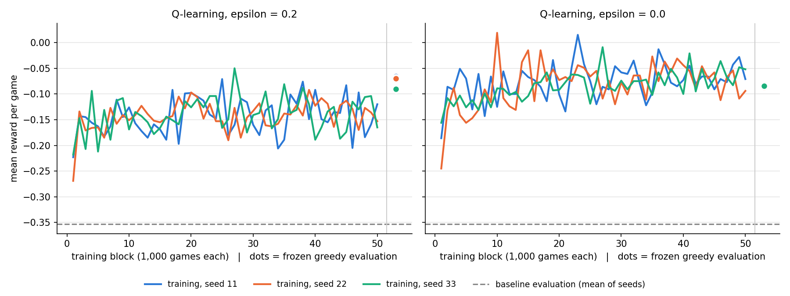

# HW7 submission — Blackjack

## AI-use declaration

Which tools did you use, and for what?

I used Claude (Anthropic) to explain the methods, to check my paper calculations.

## Setup and reproduction

Record dependency versions, installation steps and exact commands for the
paper replay, training and frozen-policy evaluation.

Versions (from [`outputs/outputs/versions.txt`](outputs/outputs/versions.txt)): Python 3.13.18, gymnasium 1.4.0, numpy 2.4.6, matplotlib 3.10.0. Environment: `Blackjack-v1`, `natural=False`, `sab=False`.

I ran everything in Google Colab (GitHub Codespaces quota was used up):

```bash
git clone https://github.com/dilyarakabysheva-jpg/css4007-hw7.git
cd css4007-hw7
pip install -r requirements.txt
python paper_replay.py        # Part C: exact replay of the paper histories
python blackjack_learn.py     # Part D: fixed-policy games, Q-learning training and frozen evaluation
```

`paper_replay.py` needs no Gymnasium; it reads `data/paper-games.csv` and `data/states.csv`. `blackjack_learn.py` writes `outputs/fixed-policy/` and `outputs/q-learning/` (uploaded here as `outputs/outputs/...`). Seeds: fixed-policy and training seeds 11, 22, 33 (passed to the first `reset`), evaluation seeds 1011, 1022, 1033, and `random.Random(seed)` for exploration and tie-breaking.

## Part A — Count states and actions

Link your paper answers and comparison table for Blackjack, Durak, tic-tac-toe
and Nim. Show formulas, assumptions, example legal actions and hidden information.

Paper: [page 1](part_a_1.jpg), [page 2](part_a_2.jpg), [page 3](part_a_3.jpg), [page 4](part_a_4.jpg)

| Game | Representation | State-count formula | Type of count | Action representation | Legal actions in example | Hidden information |
| --- | --- | --- | --- | --- | --- | --- |
| Blackjack | (sum 12–21, dealer 1–10, usable ace) | 10·10·2 = 200 (Q-table 200·2 = 400) | part of the state (no sums 4–11, no END, no hidden card) | stick / hit (2 labels) | 2 | dealer's hidden card, deck |
| Durak | own 6-card hand | C(36,6) = 1,947,792; opponent hands C(29,6) = 475,020 | part of the state | play a card / pick up / end attack | 6 (opening), 4 (defense: A♣, 7♥, Q♥, pick up) | opponent hand, stock order |
| Tic-tac-toe | 9 squares ∈ {., X, O} | 3^9 = 19,683 (5,478 reachable) | upper bound | square (9 labels) | 5 | none |
| Nim (2,3,4) | (p1, p2, p3) + player to move | 3·4·5·2 = 120 | encoding count | (pile, stones) | 9 at (2,3,4), 3 at (0,1,2), 0 at (0,0,0) | none |

Durak needs by far the largest Q-table. Action labels are fixed for the whole game, but in a given position only some are legal (occupied squares, empty piles, cards not in hand).

## Part B — Paper calculations

Link scans/photos of all four methods. Commit the original paper work before
implementing learners. Keep originals alongside any corrections.

Paper: [page 1](part_b_1.jpg) (model-based), [page 2](part_b_2.jpg) (Monte Carlo, TD pass 1, Q-learning pass 2), [page 3](part_b_3.jpg) (final Q-table, explanations, correction page: TD pass 2 and Q-learning pass 1).

The photos were committed in "Paper work: Part A and Part B" before `paper_replay.py` and `blackjack_learn.py`. On page 2 the table under "Pass 2" is the Q-learning pass 2 table; I marked it and added the missing TD pass 2 and Q-learning pass 1 on a separate correction page, keeping the original visible. In the Q-learning pass 1 correction table I did not fill the Target/New columns; the replay below gives those values.

## Part C — Reproduce the calculations

Link the fixed-history replay output in outputs/paper-replay/.

Replay: [outputs/outputs/paper-replay/replay.txt](outputs/outputs/paper-replay/replay.txt) (every update with old value, reward, successor value, target and new value), comparison: [outputs/outputs/paper-replay/comparison.md](outputs/outputs/paper-replay/comparison.md).

| Method | State / action | Sweep / pass / update | Paper result | Program result | Difference | Explanation |
| --- | --- | --- | --- | --- | --- | --- |
| Model-based | A | V1 | -0.33300 | -0.333333 | -0.000333 | rounding (-1/3 written as -0.333) |
| Model-based | B | V1 | 0.00000 | 0.000000 | +0.000000 | exact match |
| Model-based | C | V1 | 0.00000 | 0.000000 | +0.000000 | exact match |
| Model-based | D | V1 | 0.00000 | 0.000000 | +0.000000 | exact match |
| Model-based | E | V1 | 0.00000 | 0.000000 | +0.000000 | exact match |
| Model-based | A | V2 | -0.33300 | -0.333333 | -0.000333 | rounding (-1/3 written as -0.333) |
| Model-based | B | V2 | 0.00000 | 0.000000 | +0.000000 | exact match |
| Model-based | C | V2 | 0.00000 | 0.000000 | +0.000000 | exact match |
| Model-based | D | V2 | 0.00000 | 0.000000 | +0.000000 | exact match |
| Model-based | E | V2 | 0.00000 | 0.000000 | +0.000000 | exact match |
| Monte Carlo | A | final | -0.33300 | -0.333333 | -0.000333 | rounding (-1/3 written as -0.333) |
| Monte Carlo | B | final | 0.00000 | 0.000000 | +0.000000 | exact match |
| Monte Carlo | C | final | 0.00000 | 0.000000 | +0.000000 | exact match |
| Monte Carlo | D | final | 0.00000 | 0.000000 | +0.000000 | exact match |
| Monte Carlo | E | final | 0.00000 | 0.000000 | +0.000000 | exact match |
| TD(0) | A | after pass 1 | -0.08000 | -0.080000 | +0.000000 | exact match |
| TD(0) | B | after pass 1 | -0.01000 | -0.010000 | -0.000000 | exact match |
| TD(0) | C | after pass 1 | 0.00000 | 0.000000 | +0.000000 | exact match |
| TD(0) | D | after pass 1 | 0.00000 | 0.000000 | +0.000000 | exact match |
| TD(0) | E | after pass 1 | 0.00000 | 0.000000 | +0.000000 | exact match |
| TD(0) | A | after pass 2 | -0.14003 | -0.140030 | -0.000000 | exact match |
| TD(0) | B | after pass 2 | -0.01810 | -0.018100 | -0.000000 | exact match |
| TD(0) | C | after pass 2 | 0.00000 | 0.000000 | +0.000000 | exact match |
| TD(0) | D | after pass 2 | 0.00000 | 0.000000 | +0.000000 | exact match |
| TD(0) | E | after pass 2 | 0.00000 | 0.000000 | +0.000000 | exact match |
| Q-learning | A,stick | after pass 1 | not written | 0.000000 | — | Target/New left blank on paper; program value fills the gap |
| Q-learning | A,hit | after pass 1 | not written | -0.080000 | — | Target/New left blank on paper; program value fills the gap |
| Q-learning | B,stick | after pass 1 | not written | -0.010000 | — | Target/New left blank on paper; program value fills the gap |
| Q-learning | B,hit | after pass 1 | not written | 0.000000 | — | Target/New left blank on paper; program value fills the gap |
| Q-learning | C,stick | after pass 1 | not written | 0.000000 | — | Target/New left blank on paper; program value fills the gap |
| Q-learning | C,hit | after pass 1 | not written | 0.000000 | — | Target/New left blank on paper; program value fills the gap |
| Q-learning | D,stick | after pass 1 | not written | 0.000000 | — | Target/New left blank on paper; program value fills the gap |
| Q-learning | D,hit | after pass 1 | not written | 0.000000 | — | Target/New left blank on paper; program value fills the gap |
| Q-learning | E,stick | after pass 1 | not written | 0.000000 | — | Target/New left blank on paper; program value fills the gap |
| Q-learning | E,hit | after pass 1 | not written | 0.000000 | — | Target/New left blank on paper; program value fills the gap |
| Q-learning | A,stick | after pass 2 | 0.00000 | 0.000000 | +0.000000 | exact match |
| Q-learning | A,hit | after pass 2 | -0.13922 | -0.139220 | +0.000000 | exact match |
| Q-learning | B,stick | after pass 2 | -0.01810 | -0.018100 | -0.000000 | exact match |
| Q-learning | B,hit | after pass 2 | 0.00000 | 0.000000 | +0.000000 | exact match |
| Q-learning | C,stick | after pass 2 | 0.00000 | 0.000000 | +0.000000 | exact match |
| Q-learning | C,hit | after pass 2 | 0.00000 | 0.000000 | +0.000000 | exact match |
| Q-learning | D,stick | after pass 2 | 0.00000 | 0.000000 | +0.000000 | exact match |
| Q-learning | D,hit | after pass 2 | 0.00000 | 0.000000 | +0.000000 | exact match |
| Q-learning | E,stick | after pass 2 | 0.00000 | 0.000000 | +0.000000 | exact match |
| Q-learning | E,hit | after pass 2 | 0.00000 | 0.000000 | +0.000000 | exact match |

All values match my paper. The only differences are rounding (−1/3 written as −0.333) and the Q-learning pass 1 values that I left blank on paper.

## Part D — Simulated games

### Fixed-policy value estimates

Link the shared logs, checkpoint value tables and visit counts. Explain
missing states and differences among model-based, Monte Carlo and TD estimates.

- Shared game logs (one per seed, 10,000 games of the policy "hit below 20, stick at 20/21"): [seed 11](outputs/outputs/fixed-policy/games_seed11.csv), [seed 22](outputs/outputs/fixed-policy/games_seed22.csv), [seed 33](outputs/outputs/fixed-policy/games_seed33.csv). The same games are fed to all three learners.
- All estimates and visit counts at 100, 1,000 and 10,000 games: [value_estimates.csv](outputs/outputs/fixed-policy/value_estimates.csv).
- Full value tables after 10,000 games (value / visits, usable and no usable ace): [seed 11](outputs/outputs/fixed-policy/value_tables_seed11.md), [seed 22](outputs/outputs/fixed-policy/value_tables_seed22.md), [seed 33](outputs/outputs/fixed-policy/value_tables_seed33.md).
- Selected frequent and rare states at every checkpoint: [compare_states.md](outputs/outputs/fixed-policy/compare_states.md). Model-based convergence: [model_based_convergence.txt](outputs/outputs/fixed-policy/model_based_convergence.txt).

Selected states, seed 11:

| State (sum, dealer, ace) | Games | Visits | Model-based | Monte Carlo | TD(0) |
| --- | --- | --- | --- | --- | --- |
| (20, 10, no) frequent | 100 / 1,000 / 10,000 | 6 / 60 / 606 | +0.333 / +0.467 / +0.416 | +0.333 / +0.467 / +0.416 | +0.173 / +0.511 / +0.439 |
| (16, 10, no) frequent | 100 / 1,000 / 10,000 | 3 / 32 / 412 | −0.726 / −0.772 / −0.634 | −0.333 / −0.781 / −0.646 | −0.192 / −0.686 / −0.706 |
| (12, 1, yes) rare | 100 / 1,000 / 10,000 | 0 / 1 / 5 | — / −0.400 / −0.595 | — / −1.000 / −0.200 | — / +0.001 / −0.087 |
| (4, 1, no) rare | 100 / 1,000 / 10,000 | 0 / 0 / 2 | — / — / −0.698 | — / — / −1.000 | — / — / −0.088 |

- **Missing states:** after 100 games only 96–118 observations were visited, after 1,000 games 243–247 and after 10,000 games 280 in every seed. A state that was never visited has no estimate (shown as —); I do not treat it as 0. The fixed policy's action (hit or stick) was observed in every visited state, and no successor estimate was missing.
- **Model-based** policy evaluation converged in 5–12 sweeps at every checkpoint (final change below 1e-6).
- **Frequent states:** with hundreds of visits model-based and Monte Carlo are almost equal (for (20,10,no) they are identical, because sticking ends the game, so both just average the final rewards). TD(0) with α = 0.1 is close but noisier, because it keeps moving towards recent targets instead of averaging all of them.
- **Rare states:** with 1–6 visits the three methods disagree a lot. Monte Carlo averages only the few returns from that state (for example −1.000 from 2 visits). Model-based combines the few observed transitions with better-estimated successor values. TD barely moves from 0, because a few updates with α = 0.1 only take small steps.
- **Across seeds** frequent states agree well (V(20,10,no) = 0.416, 0.417, 0.455), rare states do not.

### Q-learning and baseline evaluation

| Training seed | Policy / epsilon | Evaluation seed | Wins | Losses | Draws | Cut-offs | Mean reward |
| --- | --- | --- | --- | --- | --- | --- | --- |
| 11 | baseline (hit below 20) | 1011 | 2962 | 6462 | 576 | 0 | -0.3500 |
| 11 | Q-learning eps=0.2 (training cut-offs 0) | 1011 | 4228 | 4882 | 890 | 0 | -0.0654 |
| 11 | Q-learning eps=0.0 (training cut-offs 0) | 1011 | 4100 | 4929 | 971 | 0 | -0.0829 |
| 22 | baseline (hit below 20) | 1022 | 2935 | 6481 | 584 | 0 | -0.3546 |
| 22 | Q-learning eps=0.2 (training cut-offs 0) | 1022 | 4220 | 4919 | 861 | 0 | -0.0699 |
| 22 | Q-learning eps=0.0 (training cut-offs 0) | 1022 | 4100 | 4975 | 925 | 0 | -0.0875 |
| 33 | baseline (hit below 20) | 1033 | 2950 | 6496 | 554 | 0 | -0.3546 |
| 33 | Q-learning eps=0.2 (training cut-offs 0) | 1033 | 4124 | 5025 | 851 | 0 | -0.0901 |
| 33 | Q-learning eps=0.0 (training cut-offs 0) | 1033 | 4098 | 4943 | 959 | 0 | -0.0845 |

Q-learning: α = 0.1, γ = 1, 50,000 training games per run, ε = 0.2 and ε = 0 (greedy from a zero table). The Q-table was then frozen and the greedy policy was evaluated for 10,000 games on separate evaluation seeds, with no exploration and no updates. The baseline is the fixed "hit below 20" policy on the same evaluation seeds. No game was cut off.

### Plots and learned policies

Link training curves, Q-tables, hit/stick policy tables and state-action counts.
Separate usable-ace and no-usable-ace results.



The lines are training rewards (mean per block of 1,000 games, with exploration); the dots on the right are the frozen greedy evaluations; the dashed line is the baseline evaluation.

| Run | Q-table with N(s,a) counts | Hit/stick policy (no usable ace and usable ace tables) | Training blocks |
| --- | --- | --- | --- |
| seed 11, ε 0.2 | [csv](outputs/outputs/q-learning/q_table_seed11_eps0.2.csv) | [policy](outputs/outputs/q-learning/policy_seed11_eps0.2.md) | [csv](outputs/outputs/q-learning/training_blocks_seed11_eps0.2.csv) |
| seed 11, ε 0 | [csv](outputs/outputs/q-learning/q_table_seed11_eps0.0.csv) | [policy](outputs/outputs/q-learning/policy_seed11_eps0.0.md) | [csv](outputs/outputs/q-learning/training_blocks_seed11_eps0.0.csv) |
| seed 22, ε 0.2 | [csv](outputs/outputs/q-learning/q_table_seed22_eps0.2.csv) | [policy](outputs/outputs/q-learning/policy_seed22_eps0.2.md) | [csv](outputs/outputs/q-learning/training_blocks_seed22_eps0.2.csv) |
| seed 22, ε 0 | [csv](outputs/outputs/q-learning/q_table_seed22_eps0.0.csv) | [policy](outputs/outputs/q-learning/policy_seed22_eps0.0.md) | [csv](outputs/outputs/q-learning/training_blocks_seed22_eps0.0.csv) |
| seed 33, ε 0.2 | [csv](outputs/outputs/q-learning/q_table_seed33_eps0.2.csv) | [policy](outputs/outputs/q-learning/policy_seed33_eps0.2.md) | [csv](outputs/outputs/q-learning/training_blocks_seed33_eps0.2.csv) |
| seed 33, ε 0 | [csv](outputs/outputs/q-learning/q_table_seed33_eps0.0.csv) | [policy](outputs/outputs/q-learning/policy_seed33_eps0.0.md) | [csv](outputs/outputs/q-learning/training_blocks_seed33_eps0.0.csv) |

Each policy file has two separate tables: "No usable ace" (sums 4–21) and "Usable ace" (sums 12–21).

### Explain your results

Address prediction versus control, terminal updates, usable aces, exploration,
coverage, variation across seeds and whether the learned policy improved.

- **Prediction vs control.** Model-based, Monte Carlo and TD(0) do *prediction*: they estimate V(s) of one fixed policy ("hit below 20") and never change it. Q-learning does *control*: it learns Q(s,a) for both actions and uses the max, so it improves the policy while learning.
- **Terminal updates.** When a game ends, the target is just the reward (+1, 0 or −1), because V(END) = 0 and Q(END, ·) = 0. No value is ever stored for END, and nothing is bootstrapped after the end.
- **Usable aces.** States with a usable ace are visited much less often (for example (21,1,yes) 50 times vs (20,10,no) 606 times in 10,000 games), so their estimates are noisier. The learned policies hit more often with a usable ace (for example soft 17 and soft 18 are mostly "hit" for seed 11, ε 0.2), because the ace can turn from 11 into 1 and a hit cannot bust immediately.
- **Exploration and coverage.** With ε = 0.2 every decision state (sums 12–21) had both actions tried. With ε = 0 the agent only follows its current greedy choice: in 15–23 decision states one action was never tried. Its zero value then stays untested; in all three seeds the ε = 0 policy even says "hit" on a soft 20 in 1–3 states. This is the "untried 0 is not good" problem from my paper calculations.
- **Training vs evaluation.** The ε = 0.2 training curves stay around −0.12 to −0.15, but its frozen greedy evaluation is −0.065 to −0.090, because during training 20% of actions are random. Training rewards are not the policy's real quality; only the frozen evaluation is.
- **Variation across seeds.** Evaluation mean reward: ε 0.2: −0.065, −0.070, −0.090; ε 0: −0.083, −0.088, −0.085. The learned policy tables differ between seeds in rarely visited states (low sums, usable ace), so 50,000 games are not enough for a perfectly clean policy.
- **Did the policy improve?** Yes. The baseline "hit below 20" loses about 65% of games (mean reward −0.350 to −0.355) because it hits on 18 and 19 and often busts. All six Q-learning policies lose about 49–50% (mean −0.065 to −0.090), around 0.27 per game better. Blackjack still favours the dealer, so the mean stays negative. With ε = 0.2 the result was better than ε = 0 for seeds 11 and 22 and slightly worse for seed 33, so exploration helped in most runs.
